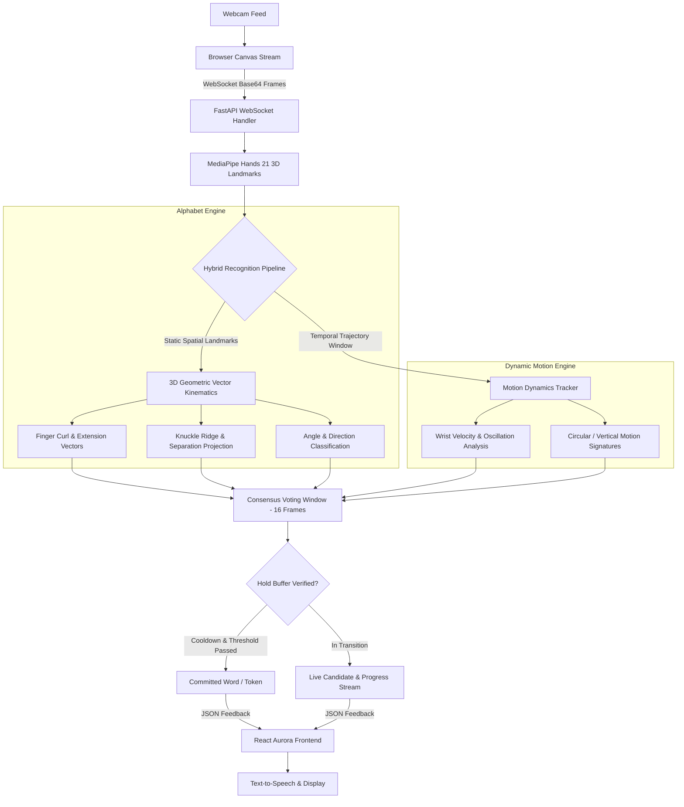

# 🤟 SignSpeak: Real-Time ASL & Motion Phrase Translator


An ultra-responsive, real-time American Sign Language (ASL) and conversational motion phrase translation system. Built with **MediaPipe Hands**, a high-precision **3D Geometric Kinematics Engine**, asynchronous **FastAPI WebSockets**, and a modern **React Aurora UI**.

---

## 🌟 Key Features

- **28 Static Alphabet Signs (A–Z, Space, Delete)**: Calibrated directly against the *Gerard Aflague Collection* standard ASL chart.
- **11 Dynamic Conversational Phrases**: Trajectory and velocity tracking for phrases such as `hello`, `bye`, `thank_you`, `sorry`, `please`, `yes`, `no`, `i_love_you`, `help`, `good`, and `idle`.
- **Sub-10ms Inference**: Pure vector mathematics running directly in the worker loop without heavy runtime bottlenecks.
- **2–3s Hold Buffer & Consensus Filter**: 16-frame sliding consensus window with hold-to-confirm feedback prevents frantic misclassification during hand transitions.
- **Text-to-Speech (TTS) & Sentence Builder**: Automatically accumulates committed signs and speaks sentences aloud.
- **Chic Twilight Aurora HUD**: Glassmorphic UI with real-time landmark mesh overlays, live confidence telemetry, and quick reference cards.

---

## 🏛️ System Architecture



---

## 🧠 Model & Recognition Pipelines

### 1. 3D Geometric Vector Kinematics (Alphabet A–Z)
Rather than relying on opaque deep models vulnerable to background lighting and hand-size variations, SignSpeak utilizes normalized 3D landmark geometry:
- **Wrist-Centric Normalization**: All 21 landmarks are translated relative to wrist landmark `0` and scaled by palm span (`0` to `9`), creating full invariance to camera distance.
- **Curl & Extension Metric**: Computed via Euclidean distances between finger tips (`4, 8, 12, 16, 20`) and knuckle joints (`2, 5, 9, 13, 17`).
- **Finger Ridge & Overlap Resolution**:
  - **`G` vs `H`**: Separated via horizontal direction vectors ($|v_y| \le 0.45$) and index-middle separation distance.
  - **`M`, `N`, `T`, `A`**: Differentiated by thumb tip projection along the metacarpal ridge ($t_{\text{knuckle}}$ between index, middle, and ring knuckles).
  - **`R` vs `U`**: Cross-finger intersection testing ($v_{x,\text{middle}} < v_{x,\text{index}}$).
  - **`C`, `O`, `E`, `S`**: Differentiated using aperture radius, thumb-to-index tip proximity, and curled thumb folding.

### 2. Spatio-Temporal Motion Dynamics (Phrases)
Motion phrases involve active gestures over time. SignSpeak tracks the last 30 frames of wrist coordinates and velocity vectors:
- **`hello` / `bye`**: High horizontal frequency oscillation ($\text{cycles} \ge 2$, $|v_x| > 0.08$) with extended open palm.
- **`yes`**: Closed fist with rhythmic vertical pitching ($v_y$ sinusoidal oscillation).
- **`no`**: Rapid pinch snapping between extended thumb and index/middle fingers.
- **`thank_you`**: Palm opening and traveling forward/downward from chin height.
- **`sorry` / `please`**: Circular palm trajectory on the chest with closed fist (`sorry`) or open flat hand (`please`).
- **`i_love_you`**: Fixed iconic hand shape (Thumb + Index + Pinky extended, Middle + Ring curled).

### 3. Stability & Pacing Layer
- **Window Size**: 25 frames (~0.8s history).
- **Consensus Threshold**: Minimum 16 matching votes required before a candidate advances.
- **Hold-to-Commit Progress**: Visual circular progress indicator fills as you hold the pose steady.
- **Cooldown Safeguard**: 2.2s cooldown on alphabet commits and 2.5s on phrases to give the signer natural time to relax or form the next sign.

---

## 📁 Repository Structure

```
sign-language-transalator/
├── backend/
│   └── main.py              # FastAPI server, WebSocket endpoints & WebRTC bridge
├── src/
│   ├── asl_geometry.py      # Core 3D Geometric Kinematics Engine
│   ├── predictor.py         # Multi-frame consensus & smoothing manager
│   ├── config.py            # Classification thresholds, cooldowns & timing parameters
│   └── landmark_utils.py    # Landmark extraction & normalization utilities
├── frontend/
│   ├── src/
│   │   ├── components/      # Video HUD, Telemetry, Reference Chart, Sentence Bar
│   │   ├── styles/          # Twilight Aurora glassmorphic design tokens
│   │   ├── App.jsx          # Main application component & WebSocket orchestrator
│   │   └── main.jsx         # React DOM mount point
│   ├── package.json
│   └── vite.config.js
├── models/                  # Optional pre-trained neural network weights
├── requirements.txt         # Python dependencies
└── README.md
```

---

## 🚀 Quick Start Guide

### Prerequisites
- **Python 3.10+**
- **Node.js 18+** & npm
- A functional webcam

### 1. Clone the Repository
```bash
git clone https://github.com/ArushiShetty/signlanguage_detection_model.git
cd signlanguage_detection_model
```

### 2. Backend Setup
```bash
# Create and activate virtual environment
python -m venv .venv

# Windows:
.\.venv\Scripts\activate

# macOS / Linux:
source .venv/bin/activate

# Install dependencies
pip install -r requirements.txt

# Start backend server
python -m uvicorn backend.main:app --host 127.0.0.1 --port 8000 --reload
```
*Backend runs at `http://127.0.0.1:8000` (Healthcheck: `http://127.0.0.1:8000/api/health`)*

### 3. Frontend Setup
Open a second terminal window:
```bash
cd frontend

# Install packages
npm install

# Start Vite dev server
npm run dev
```
*Open `http://localhost:5173` in your browser.*

---

## 🖐️ Supported Gestures Reference

| Category | Gestures |
|---|---|
| **Alphabet** | `A`, `B`, `C`, `D`, `E`, `F`, `G`, `H`, `I`, `J`, `K`, `L`, `M`, `N`, `O`, `P`, `Q`, `R`, `S`, `T`, `U`, `V`, `W`, `X`, `Y`, `Z` |
| **Control Keys** | `space` (pause / word separator), `del` (backspace character) |
| **Motion Phrases** | `hello`, `bye`, `thank_you`, `sorry`, `please`, `yes`, `no`, `i_love_you`, `help`, `good` |

---

## 🛠️ Tech Stack

- **Computer Vision**: [MediaPipe](https://developers.google.com/mediapipe), OpenCV, NumPy
- **Backend API**: [FastAPI](https://fastapi.tiangolo.com/), Uvicorn, WebSockets
- **Frontend**: [React](https://react.dev/), Vite, Web Audio / SpeechSynthesis API
- **Styling**: Vanilla CSS, Modern Glassmorphism, CSS Custom Properties

---

## 📄 License
This project is open-source and available under the [MIT License](LICENSE).
